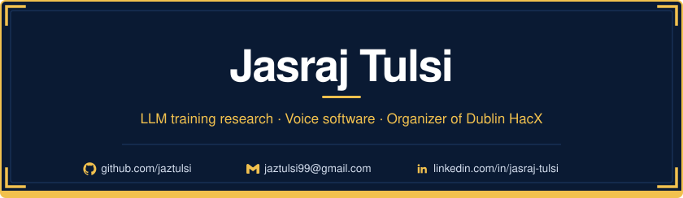
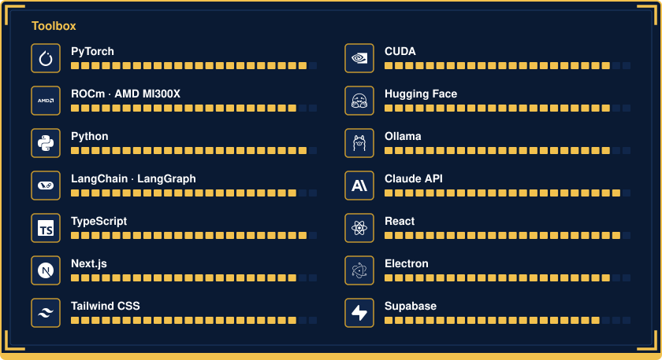
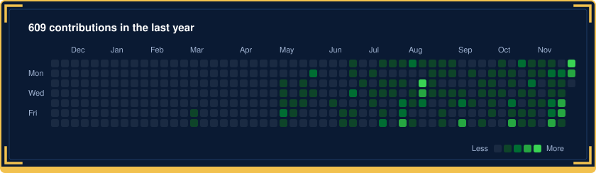
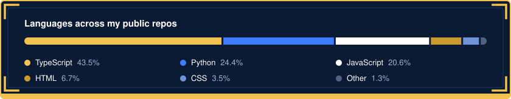

I lead [Optimizer Autopsy](https://github.com/jaztulsi/optimizer-autopsy), a research project on loss spikes in LLM training. When a run's loss jumps, we fork it, swap the weights and Adam's `m` and `v` between the spiked run and a clean twin, and measure where the lasting damage lives. Replays match the original run bit for bit on CUDA and on an AMD MI300X, so any difference comes from the edit, not from noise.

I also build voice and agent software. [Dixi](https://github.com/jaztulsi/dixi) is a browser you control by talking. Vocari expands typed first letters into full spoken sentences, offline. [IRIS](https://github.com/jaztulsi/Personal_assistant) is a macOS assistant that runs every model locally. I contribute to [ExeaLM](https://github.com/exea-labs/ExeaLM), an open 0.1B language model from Exea Labs.

I organized [Dublin HacX](https://www.dublinhacx.com), a 12-hour hackathon for 170 Bay Area high schoolers, and co-founded the Hacking & Coding Club at Emerald High.

**Currently:** preparing the pre-registered dose sweep for Optimizer Autopsy, and building Sagi, a shared workspace where people and coding assistants work on one project.

| Project | What it does | Built with |
|---|---|---|
| **[Optimizer Autopsy](https://jaztulsi.github.io/optimizer-autopsy/)** | Measures how much of a loss spike's lasting damage sits in the weights versus Adam's optimizer state, using bit-identical replay forks. | PyTorch, ROCm, AMD MI300X |
| **[Dixi](https://dixiai.vercel.app)** | Hands-free browser that runs each voice command as soon as you finish saying it. | Electron, Deepgram, Groq |
| **[Venture AI](https://devpost.com/software/venture-ai-0trjbp)** | Five agents that check a startup idea's market, product and investors. Winner at Los Altos Hacks X. | React, Express, OpenAI |
| **[ExeaLM](https://huggingface.co/exea-labs/ExeaLM)** | Open 0.1B model with built-in retrieval and agent-to-agent messaging. I added the beginner training notebook and the architecture-search plots. | PyTorch |
| **[Neural Lanes](https://github.com/jaztulsi/neural-lanes)** | Bowling game against a Dueling Double-DQN that learns after every throw and remembers you between sessions. | PyTorch, Pygame |
| **[Web Research Agent](https://github.com/jaztulsi/web-research-agent)** | Plans a question, sends parallel sub-agents to research it, and writes a cited report with every link checked. | LangGraph, Claude API |

[jaztulsi99@gmail.com](mailto:jaztulsi99@gmail.com) · [LinkedIn](https://www.linkedin.com/in/jasraj-tulsi-853b89344/) · [Devpost](https://devpost.com/jaztulsi) · [Hugging Face](https://huggingface.co/jaztulsi)
